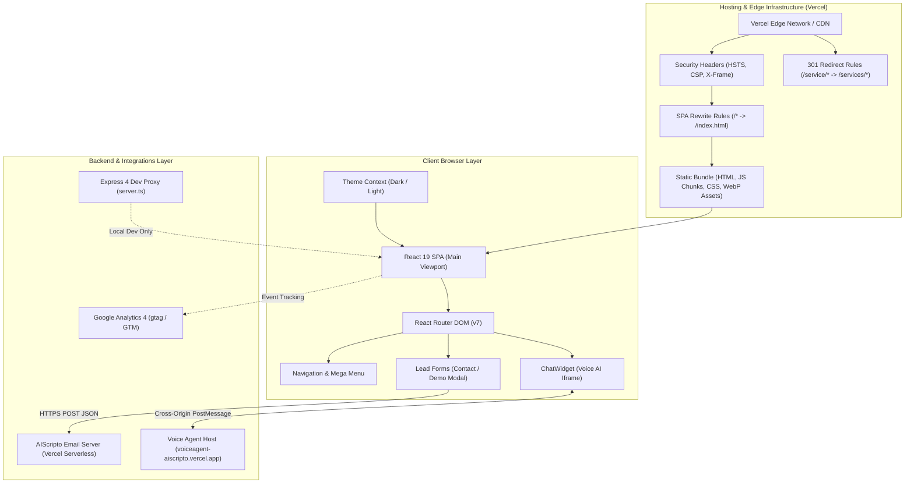

# AIScripto Website — System Architecture

**Version:** 1.0.0  
**Status:** Verified Architecture  
**Target Platform:** Static Edge CDN (Vercel) + Node.js (Local/Express Dev Proxy)  

---

## 1. System Overview

The AIScripto web application is a high-performance, single-page application (SPA) architected for enterprise marketing, service presentation, product discovery, live interactive demonstrations, and sales lead capture.

### Architectural Tenets
1. **Static First, Edge Delivered:** The entire frontend compiles down to immutable, optimized static chunks (`dist/assets/`) distributed via Vercel's global Edge Network with sub-100ms time-to-first-byte (TTFB).
2. **Predictable SPA Routing:** Client-side routing managed by React Router DOM v7 with route-level code splitting via `React.lazy()` and `Suspense`.
3. **Decoupled API Integrations:** All user lead generation (contact inquiries, quote requests, demo bookings) is processed through a structured HTTP client adapter layer (`src/utils/service.ts`) targeting an external or serverless API gateway (`VITE_API_BASE_URL`).
4. **Third-Party Agent Embedding:** The AI Voice Chatbot runs as an isolated iframe communicating with the host page via a secure `postMessage` protocol with origin verification.

---

## 2. Architecture & Data Flow Diagram



---

## 3. Directory & Module Boundaries

```
AIScriptWebSite/
├── docs/                     # Architecture, SEO audit, and decision records
├── public/                   # Public static assets, images, robots.txt, sitemap.xml
│   ├── images/products/      # Responsive WebP, PNG, and SVG product previews
│   ├── ai-catalog.json       # AI agent catalog schema for scrapers
│   ├── llms.txt              # LLM documentation discovery file
│   └── robots.txt            # Search crawler directives
├── scripts/                  # Build automation scripts
│   └── generate-sitemap.ts   # Static XML sitemap generator
├── src/
│   ├── components/           # Reusable UI components
│   │   ├── ChatWidget.tsx    # Voice AI embed iframe widget
│   │   ├── DemoBookingModal  # Modal lead capture dialog
│   │   ├── Footer.tsx        # Global footer & compliance links
│   │   ├── Navbar.tsx        # Top utility bar, header & desktop/mobile mega menus
│   │   ├── ProductCard.tsx   # Standardized product showcase card
│   │   ├── Seo.tsx           # Dynamic title, Open Graph, canonical & meta tags
│   │   └── WhatsAppButton.tsx# Direct WhatsApp lead channel
│   ├── config/               # App-level configuration (SEO defaults)
│   ├── data/                 # In-memory structured datasets
│   │   ├── blogPosts.ts      # Thought leadership articles
│   │   ├── caseStudies.ts    # Enterprise case studies & ROI metrics
│   │   └── products.ts       # Flagship products & live demo configurations
│   ├── hooks/                # Custom React hooks (useTheme)
│   ├── pages/                # 25 Routed view components
│   ├── utils/                # Utilities (Tailwind cn, API client service.ts)
│   ├── App.tsx               # Root application component & route tree
│   ├── main.tsx              # React 19 root bootstrap
│   └── index.css             # Tailwind v4 configuration & theme tokens
├── server.ts                 # Express proxy for development & preview
├── vercel.json               # Vercel edge deployment rules & headers
├── vite.config.ts            # Vite build pipeline & plugin configuration
└── tsconfig.json             # TypeScript compiler settings
```

---

## 4. Major System Components & Boundaries

### A. Routing & Navigation Boundary
- **Router:** `BrowserRouter` configured in `src/App.tsx`.
- **Code Splitting:** Dynamic `React.lazy()` imports for all sub-pages, with `Home.tsx` statically imported for instant initial load and high LCP performance.
- **Scroll Restoration & Analytics:** `ScrollToTop` hook synchronizes window scroll to `(0,0)` or element hashes, and fires GA4 `page_path` tracking events on route changes.
- **Fallbacks & 404:** Wildcard route `*` resolves to `NotFound.tsx` with `noindex,nofollow` robots tag.
- **Legacy Compatibility:** Redirects from singular `/service/*` to `/services/*` and legacy aliases (e.g., `/products/ai-pos` -> `/products/pos-restaurant`) handled at both edge (`vercel.json`) and application level.

### B. UI Component & Theme Boundary
- **Design Tokens:** Strict HSL CSS custom properties defined in `src/index.css` under `:root` and `.dark`.
- **Palette:** 
  - Primary Brand Teal: `#4cbaab` (`hsl(172 45% 52%)`)
  - Accent Gold/Amber: `#f9b01e` (`hsl(40 96% 55%)`)
- **Theme System:** `ThemeProvider` writes `.light` or `.dark` class to `document.documentElement` and synchronizes with `localStorage`.

### C. Backend & API Integration Boundary
- **Transport Layer:** Axios HTTP client instance in `src/utils/service.ts` configured with 10-second timeout and JSON serialization.
- **Endpoints:**
  - `POST /api/sendQuote`: Dispatches quote requests, enterprise consultation bookings, and demo requests to the serverless email handler (`https://aiscripto-email-server.vercel.app`).
  - `POST /api/sendEmail`: General contact form delivery.
- **Error Handling:** Client catches network/server errors and displays user-friendly toast alerts via `react-hot-toast`, never swallowing lead submission failures.

### D. Third-Party Agent & Security Boundary
- **Voice Agent Iframe:** Embedded in `ChatWidget.tsx` loading `https://voiceagent-aiscripto.vercel.app/voice?tenant=...&token=...`.
- **Cross-Origin Security:**
  - CSP `frame-src 'self' https://voiceagent-aiscripto.vercel.app` in `index.html`.
  - Origin verification via `event.origin === AGENT_ORIGIN` before accepting `voice-agent:close` or status events.
  - Full-duplex audio support via `allow="microphone; autoplay"`.

---

## 5. Deployment & Edge Infrastructure

- **Target Host:** Vercel Static Hosting.
- **Edge Configuration (`vercel.json`):**
  - **Security Headers:** Strict Transport Security (HSTS 1 year), `X-Content-Type-Options: nosniff`, `X-Frame-Options: DENY`, `Referrer-Policy: strict-origin-when-cross-origin`.
  - **Rewrites:** Client-side SPA fallback route (`/(.*) -> /index.html`).
  - **Redirects:** Permanent 301 edge redirects for legacy URLs and canonical URL enforcement.
- **Build Pipeline:**
  1. `npm run generate:sitemap`: Generates `public/sitemap.xml` with dynamic routes from data modules.
  2. `vite build`: Compiles TypeScript, tree-shakes modules, splits CSS chunks, and outputs static bundles into `dist/`.
