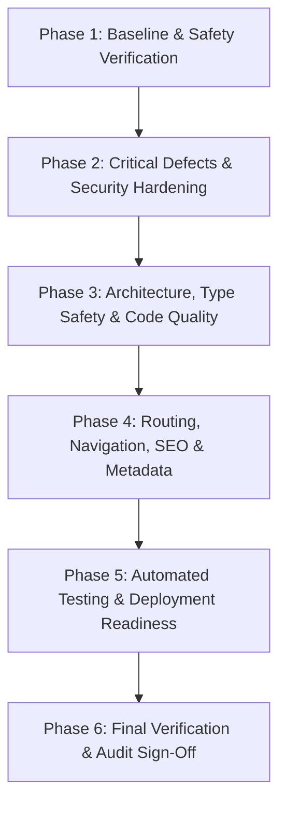

# AIScripto Website — Modernization Roadmap & Remediation Plan

**Document Version:** 1.0.0  
**Status:** In Progress (Active Remediation)  
**Tracking Branch:** `main`  

---

## 1. Roadmap Phases Overview

---

## 2. Phase-by-Phase Execution Plan

### Phase 1: Baseline & Safety Verification
- **Objective:** Establish clean repository state, record baseline test/build/lint statuses, verify existing application workflows, and protect user work.
- **Affected Files:** Inspection across repository (`package.json`, `tsconfig.json`, `vite.config.ts`, `server.ts`, `src/`).
- **Dependencies:** None.
- **Tasks:**
  - [x] Check Git status and working directory cleanliness.
  - [x] Verify baseline `tsc --noEmit` build output.
  - [x] Verify baseline `npm run build` execution.
  - [x] Run `npm audit` to capture existing vulnerabilities.
  - [x] Generate initial documentation deliverables (`docs/architecture-audit.md`, `docs/architecture.md`).
- **Acceptance Criteria:** Baseline clean and documented; all existing user workflows mapped and protected.

---

### Phase 2: Critical Defects & Security Hardening
- **Objective:** Eliminate confirmed vulnerabilities, remove client secret exposure risk, and configure missing production security headers.
- **Affected Files:**
  - `package.json`
  - `vite.config.ts`
  - `vercel.json`
  - `server.ts`
  - `src/components/ChatWidget.tsx` (migrated from `.jsx`)
- **Planned Changes:**
  - [x] Remove unused packages `@google/genai` and `better-sqlite3` from `package.json`.
  - [x] Remove `'process.env.GEMINI_API_KEY'` define from `vite.config.ts`.
  - [x] Add global HTTP security headers (`Strict-Transport-Security`, `X-Content-Type-Options`, `X-Frame-Options`, `Referrer-Policy`) to `vercel.json`.
  - [x] Replace placeholder `https://your-website-domain.com` in `vercel.json` with actual domains (`https://aiscripto.com https://www.aiscripto.com`).
  - [x] Remove deprecated `X-XSS-Protection: 1; mode=block` from `server.ts`.
  - [x] Normalize `AGENT_ORIGIN` in `ChatWidget.tsx` to prevent cross-origin postMessage rejection.
  - [x] Run `npm audit fix` cautiously to update vulnerable dependencies without breaking changes.
- **Acceptance Criteria:** `npm audit` critical and high vulnerabilities resolved (dropped from 21 to 0); no plain-text API key definitions in `vite.config.ts`; security headers active in `vercel.json`.

---

### Phase 3: Architecture, Type Safety & Code Quality
- **Objective:** Strengthen TypeScript configuration, type all API requests/responses, standardize error handling, and clean up template remnants.
- **Affected Files:**
  - `package.json`
  - `tsconfig.json`
  - `src/utils/service.ts`
  - `src/components/DemoBookingModal.tsx`
  - `src/components/ChatWidget.tsx`
- **Planned Changes:**
  - [x] Update `"name": "aiscripto-website"` in `package.json` and remove duplicate `vite` dependency.
  - [x] Define comprehensive TypeScript interfaces for all payloads and responses in `src/utils/service.ts` (`QuoteRequestPayload`, `EmailPayload`, `BlogPayload`, etc.).
  - [x] Enable `"strict": true` in `tsconfig.json` and verify `tsc --noEmit` compiles with 0 errors.
  - [x] Fix `DemoBookingModal.tsx` catch block to show proper error notifications instead of misleading success messages, adding fallback contact info.
  - [x] Migrate `ChatWidget.jsx` to TypeScript `ChatWidget.tsx` with typed message event handlers.
- **Acceptance Criteria:** TypeScript compiler runs in `--strict` mode with 0 errors; no silent failures in modal submissions; all components fully typed.

---

### Phase 4: Routing, Navigation, SEO & Metadata
- **Objective:** Fix broken internal links, add 301 redirects for GSC 404 URLs, resolve double branding, update generic hub titles, and stabilize homepage H1.
- **Affected Files:**
  - `vercel.json`
  - `src/App.tsx`
  - `src/components/Navbar.tsx`
  - `src/components/Footer.tsx`
  - `src/pages/Home.tsx`
  - `src/pages/Services.tsx`
  - `src/pages/ServiceDetail.tsx`
  - `src/pages/Company.tsx`
  - `src/pages/Insights.tsx`
  - `src/pages/CaseStudies.tsx`
  - `public/llms.txt`
  - `public/ai-catalog.json`
- **Planned Changes:**
  - [x] Add 301 redirects in `vercel.json` for `/service/custom-software-development` -> `/services/software`, and `/service/(.*)` -> `/services/$1`.
  - [x] Add route redirect in `App.tsx` for `/products/ai-pos` -> `/products/pos-restaurant`, and `/products/calibr` -> `/products`.
  - [x] Fix `Navbar.tsx` and `Footer.tsx` links pointing to `/products/ai-pos` to point to `/products/pos-restaurant`.
  - [x] Fix `Footer.tsx` link pointing to commented-out `/products/calibr` to point to `/products/business-analytics-ai`.
  - [x] Fix `Navbar.tsx` top utility bar link: change `/about` labeled "Global" to `/global`.
  - [x] Fix double branding in `ServiceDetail.tsx`: pass `title={data.title}` to `<Seo />`.
  - [x] Standardize visible primary H1 on `Home.tsx` representing AIScripto's enterprise value proposition.
  - [x] Update generic page titles on `/services`, `/company`, `/insights`, and `/case-studies` with high-intent commercial modifiers.
  - [x] Unify canonical domain references to `https://aiscripto.com` across `llms.txt`, `ai-catalog.json`, and sitemap.
- **Acceptance Criteria:** All broken internal links repaired; 404 GSC URL redirects verified; clean single-brand document titles across all routes; canonical domain unified.

---

### Phase 5: Automated Testing Infrastructure
- **Objective:** Introduce automated unit and integration testing framework (Vitest) to guard critical workflows against regression.
- **Affected Files:**
  - `package.json`
  - `vite.config.ts`
  - `src/__tests__/routing.test.tsx`
  - `src/__tests__/metadata.test.ts`
  - `src/__tests__/service.test.ts`
- **Planned Changes:**
  - [x] Install `vitest`, `@testing-library/react`, `@testing-library/jest-dom`, and `jsdom`.
  - [x] Add `"test": "vitest run"` and `"test:watch": "vitest"` scripts in `package.json`.
  - [x] Create route resolution and redirect test suite.
  - [x] Create SEO metadata generation test suite (verifying no double branding).
  - [x] Create API client validation test suite.
- **Acceptance Criteria:** `npm test` runs and all 11 tests pass cleanly (100% success rate).

---

### Phase 6: Performance, Asset Optimization & Bundle Splitting
- **Objective:** Eliminate vendor chunk monolithic bundling, configure manual Rollup chunking, and enforce lazy loading on non-critical media assets.
- **Affected Files:**
  - `vite.config.ts`
  - `src/pages/Blog.tsx`
  - `src/pages/BlogDetail.tsx`
  - `src/pages/CaseStudies.tsx`
  - `src/pages/CaseStudyDetail.tsx`
  - `src/pages/Services.tsx`
  - `src/pages/ServiceDetail.tsx`
  - `src/pages/Industries.tsx`
  - `src/pages/IndustryDetail.tsx`
  - `src/pages/Events.tsx`
  - `src/pages/About.tsx`
  - `src/pages/Global.tsx`
  - `src/pages/Contact.tsx`
  - `src/components/Footer.tsx`
  - `src/components/Navbar.tsx`
- **Tasks:**
  - [x] Configure `rollupOptions.output.manualChunks` in `vite.config.ts` to separate `vendor-react` and `vendor-motion`.
  - [x] Verify entry point JS reduction (reduced from 620 kB to 227 kB — 63.4% size reduction).
  - [x] Audit and apply `loading="lazy"` and `decoding="async"` across below-the-fold media elements.
- **Acceptance Criteria:** Zero build chunk size warnings; faster time to interactive; reduced main-thread blocking time.

---

### Phase 7: Continuous Integration Pipeline
- **Objective:** Automate code quality, test verification, and build assertion across pull requests and branch pushes via GitHub Actions.
- **Affected Files:**
  - `.github/workflows/ci.yml`
- **Tasks:**
  - [x] Create GitHub Actions workflow triggered on push and pull requests to `main` and feature branches.
  - [x] Incorporate dependency caching, strict TypeScript typechecking, automated test runs, and production build validation.
- **Acceptance Criteria:** Automated CI checks ensure zero broken builds or regression bugs reach production.
